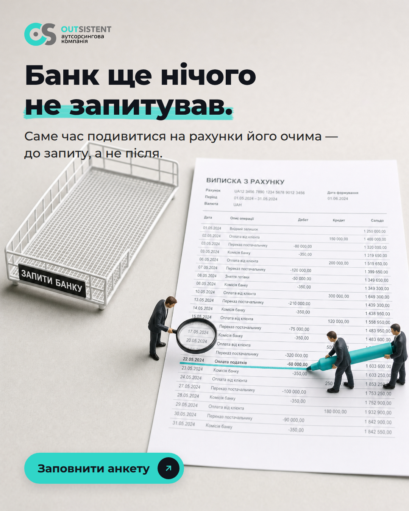
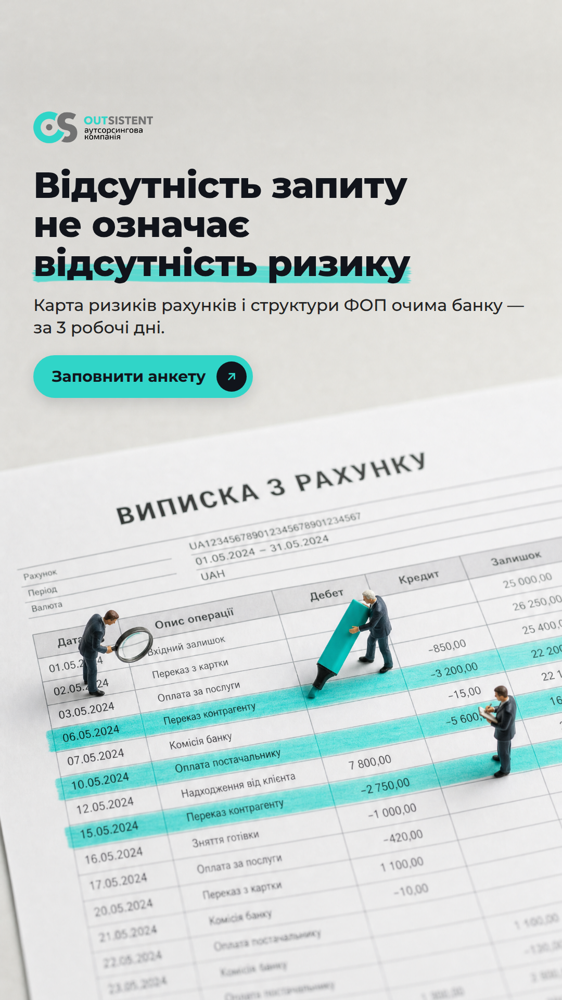
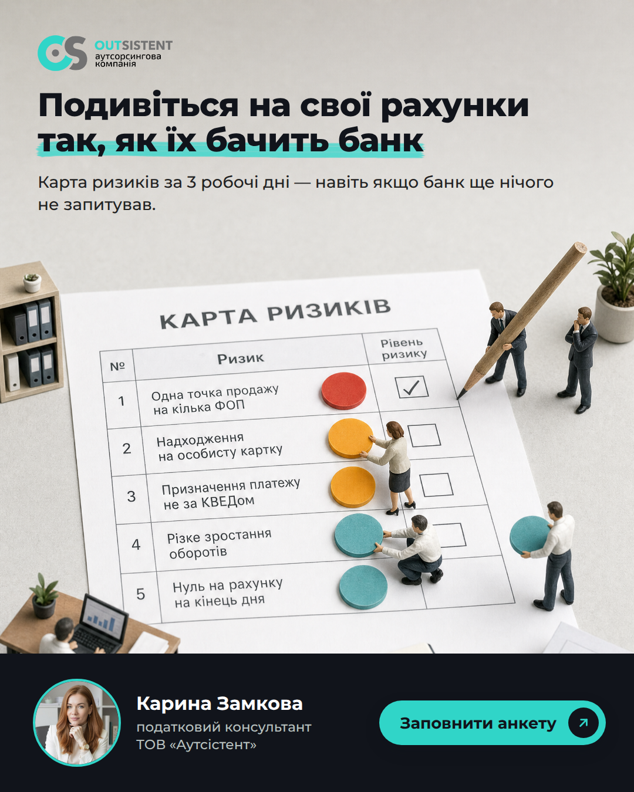
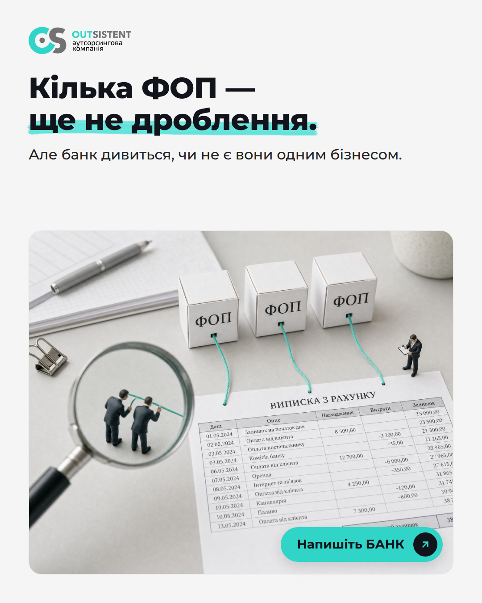
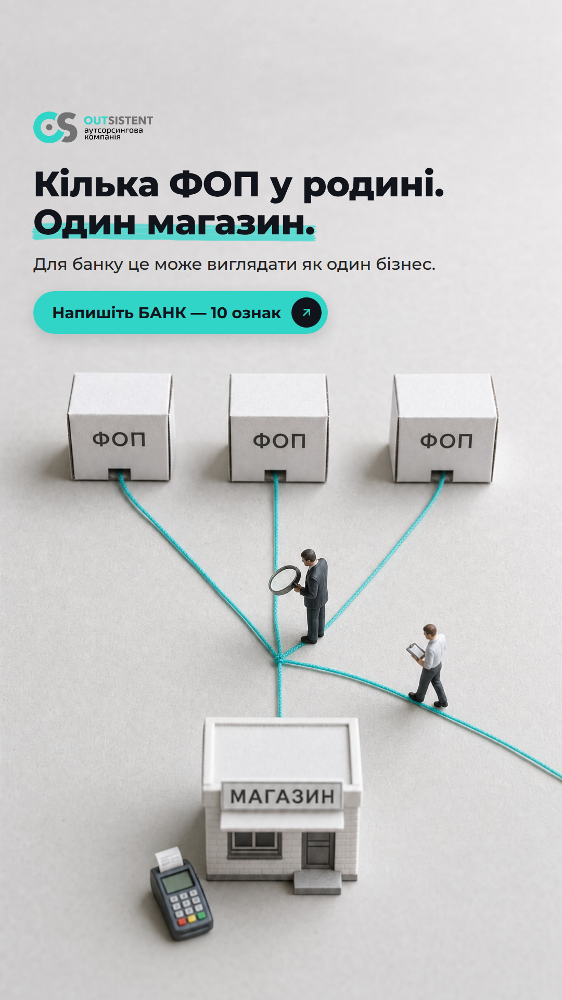
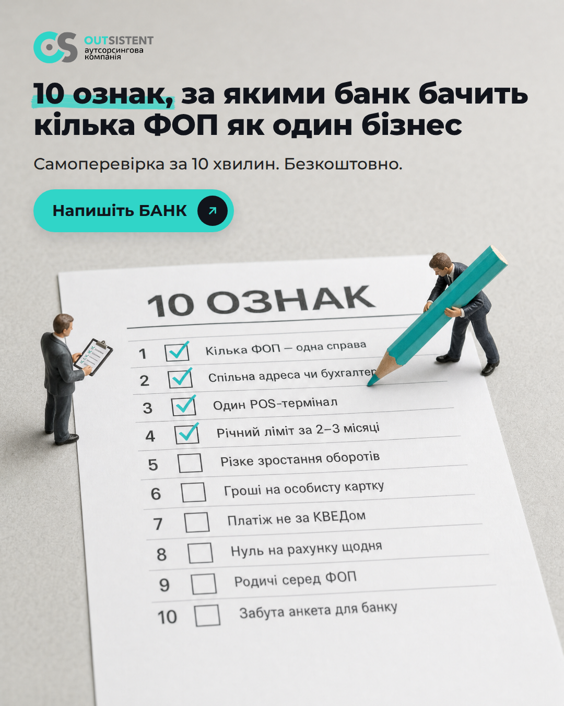
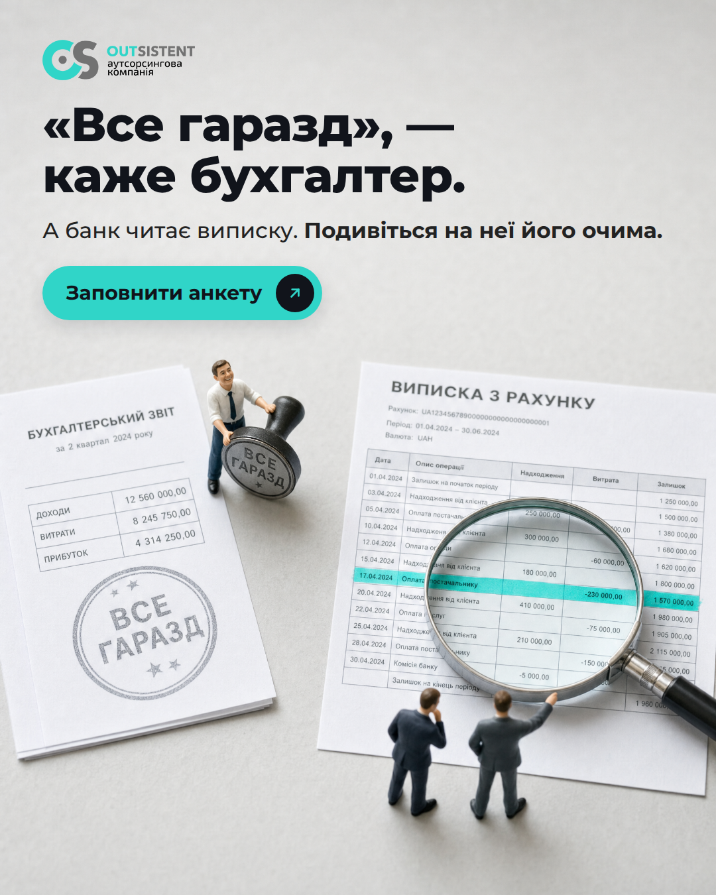
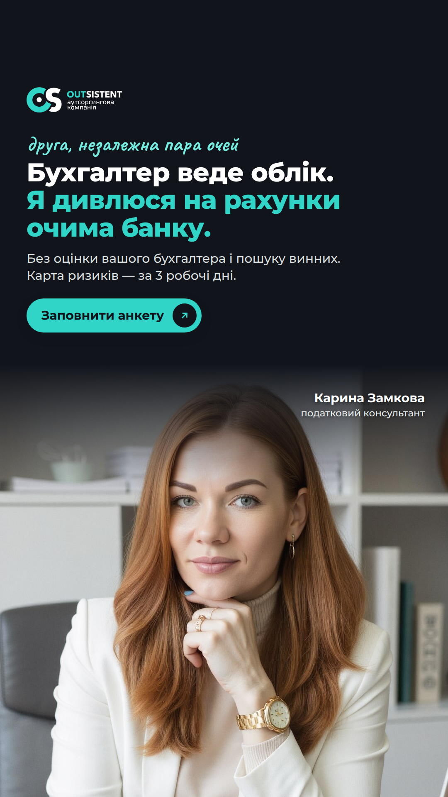
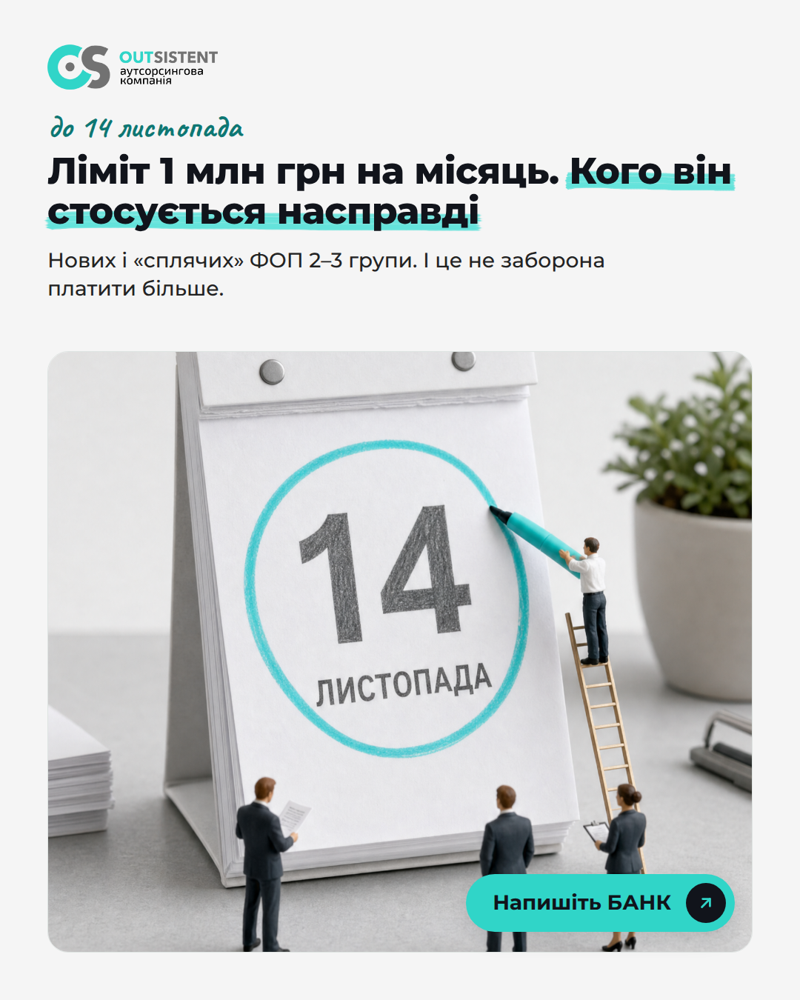
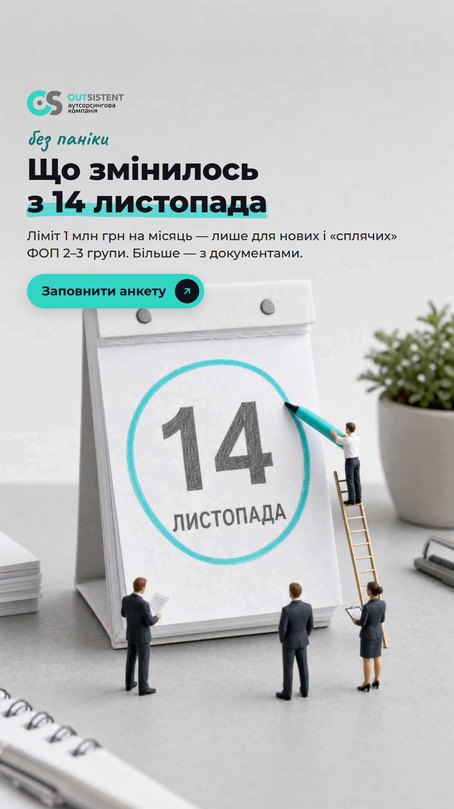

# Креативы Meta · «Очима банку» · 2026-10-26

Пакет для теста из `research/decision.md` и `research/marketing/plan.md`: 10 статик (6 × 4:5 для ленты, 4 × 9:16 для Stories/Reels) и 2 видео 9:16 по 5 секунд. Углы и правила — в `creatives/brief.md`. Контакт-лист — `creatives/contact-sheet.jpg`. Ничего не загружено в рекламный кабинет и не опубликовано.

Как собрано: сцены-диорамы — Higgsfield `gpt_image_2` (2k, промпты в `creatives/src/scene_prompts.json`), видео — `seedance_2_0` (720p, 5 с, без звука, апскейл до 1080×1920). Заголовки, логотип и кнопки наложены кодом (`creatives/src/render.py`, HTML → headless Chrome; видео — `creatives/src/make_video.sh`, ffmpeg). Лицо Карины не генерировалось: в A3 и C2 стоит её фото `brand/assets/instagram/avatar_karina_zamkova.jpg` без изменений, только кадрирование.

Ссылки на анкету с `utm_content` = код креатива: Tally передаёт параметры в скрытые поля, если поле «источник» заведено в анкете (план, неделя 1). В одной группе объявлений держим все углы сразу: Meta сама решает, кому показать мягкий вход (БАНК), а кому оффер.

## Сводная таблица

| Код | Угол | Формат | Заголовок | Кнопка | Тестируем | Файл |
|---|---|---|---|---|---|---|
| A1 | Банк ще нічого не запитував | Статика 4:5 · лента FB/IG | Рахунки очима банку — до запиту | Докладніше | хук-констатация «ще не запитував» | [A1_bank-ne-zapytuvav_4x5.png](out/A1_bank-ne-zapytuvav_4x5.png) |
| A2 | Банк ще нічого не запитував | Статика 9:16 · Stories/Reels | Виписка очима банку — до запиту | Докладніше | хук-фраза Карины + признаки выписки | [A2_vidsutnist-zapytu_9x16.png](out/A2_vidsutnist-zapytu_9x16.png) |
| A3 | Банк ще нічого не запитував | Статика 4:5 · лента FB/IG | Експрес-перевірка «Очима банку» | Подати заявку | прямой оффер + лицо (низ воронки) | [A3_karyna-karta-ryzykiv_4x5.png](out/A3_karyna-karta-ryzykiv_4x5.png) |
| B1 | Кілька ФОП на родину | Статика 4:5 · лента FB/IG | Що бачить банк у групі ФОП | Надіслати повідомлення | снятие возражения, мягкий вход БАНК | [B1_kilka-fop-ne-droblennia_4x5.png](out/B1_kilka-fop-ne-droblennia_4x5.png) |
| B2 | Кілька ФОП на родину | Статика 9:16 · Stories/Reels | Чек-лист «10 ознак» — безкоштовно | Надіслати повідомлення | бытовая сцена «родня + один магазин» | [B2_rodyna-odyn-magazyn_9x16.png](out/B2_rodyna-odyn-magazyn_9x16.png) |
| B3 | Кілька ФОП на родину | Статика 4:5 · лента FB/IG | Самоперевірка: 10 ознак за 10 хвилин | Надіслати повідомлення | лид-магнит как креатив | [B3_10-oznak-chek-lyst_4x5.png](out/B3_10-oznak-chek-lyst_4x5.png) |
| C1 | Бухгалтер каже, що все гаразд | Статика 4:5 · лента FB/IG | Друга пара очей на рахунки ФОП | Докладніше | диорама против текущего видео | [C1_vse-garazd-kazhe-buhgalter_4x5.png](out/C1_vse-garazd-kazhe-buhgalter_4x5.png) |
| C2 | Бухгалтер каже, що все гаразд | Статика 9:16 · Stories/Reels | Незалежний погляд на рахунки ФОП | Докладніше | лицо эксперта против диорамы C1 | [C2_karyna-druga-para-ochei_9x16.png](out/C2_karyna-druga-para-ochei_9x16.png) |
| D1 | Повод 14 листопада | Статика 4:5 · лента FB/IG | Ліміт з 14.11: кого він стосується | Надіслати повідомлення | новость до 14.11, вход БАНК | [D1_14-lystopada-do_4x5.png](out/D1_14-lystopada-do_4x5.png) |
| D2 | Повод 14 листопада | Статика 9:16 · Stories/Reels | Що змінилось з 14 листопада | Докладніше | новость после 14.11, вход анкета | [D2_14-lystopada-pislia_9x16.png](out/D2_14-lystopada-pislia_9x16.png) |
| V1 | Банк ще нічого не запитував | Видео 9:16, 5 с · Reels/Stories | Виписка очима банку — до запиту | Докладніше | движение против статики A2 | [V1_vypyska-ochyma-banku_9x16.mp4](out/V1_vypyska-ochyma-banku_9x16.mp4) |
| V2 | Кілька ФОП на родину | Видео 9:16, 5 с · Reels/Stories | Чек-лист «10 ознак» — безкоштовно | Надіслати повідомлення | движение против статики B2 | [V2_rodyna-odyn-magazyn_9x16.mp4](out/V2_rodyna-odyn-magazyn_9x16.mp4) |

## Три сильнейших (на мой взгляд, до данных)

1. **B2 · «Кілька ФОП у родині. Один магазин.»** Картинка сама рассказывает мысль: нитки от трёх коробок «ФОП» сходятся в один магазин и один терминал. Ядро сегмента узнаёт себя за секунду, а микро-ФОП без группы — нет, так что креатив сам фильтрует. Вход мягкий (БАНК), без «ви + проблема». Есть видео-версия V2.
2. **A2 / V1 · «Відсутність запиту не означає відсутність ризику».** Её собственная фраза бьёт в главный барьер теста, а подсвеченные строки выписки показывают, что именно смотрит банк. Тот же хук в статике и в движении — чистое сравнение формата.
3. **C1 · «„Все гаразд“, — каже бухгалтер.»** Штамп «ВСЕ ГАРАЗД» рядом с лупой над выпиской даёт напряжение с улыбкой, без страшилки и без нападок на бухгалтера. Барьер уже идёт в видео Outsistent, и C1 показывает, какой формат даёт анкету дешевле.

## Расход Higgsfield

| Что | Штук | Кредитов |
|---|---|---|
| Сцены `gpt_image_2`, 2k, high | 8 (7 в работе + 1 отбракованная: генератор вписал в чек-лист пункты про «саморозвиток», переделано) | 52 |
| Видео `seedance_2_0`, 720p, 5 с, без звука | 2 | 45 |
| **Итого** | | **97 из 160** |

Сцена с лендинга `assets/gen/bank-sees.png` использована повторно (B1), новых кредитов не стоила. Аккаунт Higgsfield общий: пока шла работа, параллельная сессия сгенерировала ещё 5 картинок (32,5 кредита), в эти 97 они не входят.


**Как читать «Проверку».** «Нельзя» — список из `research/synthesis/for-landing.md` (банк не заблокує, без штрафів, аудиторський висновок/звіт, ліміт для всіх ФОП, +40–50%, 100 000 грн, ніхто, крім нас). «Meta» — личные характеристики (не утверждаем ничего о финансовом положении зрителя), нереалистичные обещания, язык. ✓ — чисто, ⚠ — нужно решение или подтверждение до запуска.

## A1 · Банк ще нічого не запитував · Статика 4:5 · лента FB/IG



- **Файл:** `creatives/out/A1_bank-ne-zapytuvav_4x5.png` · сцена: `creatives/scenes/s1_empty_tray.png`
- **Стадия:** cold · problem-unaware
- **Текст на картинке:** «Банк ще нічого не запитував.» / «Саме час подивитися на рахунки його очима — до запиту, а не після.» / кнопка «Заповнити анкету»
- **Primary text, коротко** (116 ✓ зн.):
  > Банк ще нічого не запитував — і це найкращий момент подивитися на рахунки його очима. Карта ризиків за 3 робочі дні.
- **Primary text, длинно** (541 зн.):

```text
«Банк нічого не питав — значить, усе гаразд».
Розумію цю логіку. Але відсутність запиту не означає відсутність ризику.

Банки обмінюються інформацією про клієнтів з ознаками підозрілості. І дивляться не на кожен ФОП окремо, а на картину в цілому.

Експрес-перевірка «Очима банку»:
▫️ карта ризиків рахунків і структури ФОП: критично, важливо, допустимо
▫️ список документів, які варто мати під рукою
▫️ план дій і розбір онлайн

3 робочі дні. Навіть якщо банк ще нічого не запитував.
Почніть з анкети: 5–7 хвилин, без оплати та зобов'язань 👇
```

- **Заголовок** (31 ✓ зн.): Рахунки очима банку — до запиту
- **Описание** (25 ✓ зн.): Анкета 5–7 хв, без оплати
- **Кнопка Meta:** Докладніше (Learn more)
- **Куда ведёт:** Анкета: https://karina.kovcheg.ai/anketa/?utm_source=meta&utm_medium=paid&utm_campaign=ochyma_banku&utm_content=A1 · после запуска лендинга — {ЗАПОЛНИТЬ: URL сторінки «Очима банку», коли її опублікують}
- **Гипотеза:** Холодный владелец без запросов от банка читает «ще не запитував» как окно возможности, а не как угрозу. Против A2: спокойная констатация против формулы «відсутність запиту ≠ відсутність ризику».
- **Что смотрим:** CTR ссылки, цена анкеты, доля анкет с 2+ ФОП или ТОВ
- **Проверка:** «Нельзя» ✓. Meta ✓: состояние зрителя не утверждается; факт об обмене данными без даты (дата Меморандума у источников расходится). ⚠ «3 робочі дні» — гипотеза пилота (`decision.md`): запускать после подтверждения Карины, иначе заменить на «за кілька робочих днів» в тексте и на картинке.

## A2 · Банк ще нічого не запитував · Статика 9:16 · Stories/Reels



- **Файл:** `creatives/out/A2_vidsutnist-zapytu_9x16.png` · сцена: `creatives/scenes/s2_statement_rows.png`
- **Стадия:** cold · problem-aware
- **Текст на картинке:** «Відсутність запиту не означає відсутність ризику» / «Карта ризиків рахунків і структури ФОП очима банку — за 3 робочі дні.» / «Заповнити анкету»
- **Primary text, коротко** (104 ✓ зн.):
  > Відсутність запиту від банку не означає відсутність ризику. Подивіться на виписку так, як її читає банк.
- **Primary text, длинно** (404 зн.):

```text
Що насторожує банк у виписці ФОП:
▫️ різке зростання оборотів проти заявлених
▫️ надходження на особисту картку паралельно з ФОП
▫️ призначення платежу не за КВЕДом
▫️ нуль на рахунку на початок і кінець дня

Це не привід для тривоги. Це привід подивитися на свої рахунки так само, як на них дивиться банк.

Експрес-перевірка «Очима банку»: карта ризиків і план дій за 3 робочі дні.
Анкета — 5–7 хвилин 👇
```

- **Заголовок** (31 ✓ зн.): Виписка очима банку — до запиту
- **Описание** (29 ✓ зн.): Карта ризиків за 3 робочі дні
- **Кнопка Meta:** Докладніше (Learn more)
- **Куда ведёт:** Анкета: https://karina.kovcheg.ai/anketa/?utm_source=meta&utm_medium=paid&utm_campaign=ochyma_banku&utm_content=A2 · после запуска лендинга — {ЗАПОЛНИТЬ: URL сторінки «Очима банку», коли її опублікують}
- **Гипотеза:** Фраза Карины с её лендинга плюс список признаков в тексте дают больше целевых анкет, чем абстрактный «ризик». Подсвеченные строки выписки показывают, что именно смотрит банк.
- **Что смотрим:** CTR ссылки, цена анкеты, доля целевых; в паре с V1 — статика против движения
- **Проверка:** «Нельзя» ✓. Meta ✓: признаки выписки поданы как то, что смотрит банк, а не как «у вас». ⚠ «3 робочі дні» — гипотеза пилота (`decision.md`): запускать после подтверждения Карины, иначе заменить на «за кілька робочих днів» в тексте и на картинке.

## A3 · Банк ще нічого не запитував · Статика 4:5 · лента FB/IG



- **Файл:** `creatives/out/A3_karyna-karta-ryzykiv_4x5.png` · сцена: `creatives/scenes/s7_risk_map_bank.png + реальное фото Карины`
- **Стадия:** warm/hot · solution-aware (оффер)
- **Текст на картинке:** «Подивіться на свої рахунки так, як їх бачить банк» / «Карта ризиків за 3 робочі дні — навіть якщо банк ще нічого не запитував.» / Карина Замкова · податковий консультант · ТОВ «Аутсістент» / «Заповнити анкету»
- **Primary text, коротко** (89 ✓ зн.):
  > Подивіться на свої рахунки так, як їх бачить банк, — до того, як він попросить документи.
- **Primary text, длинно** (457 зн.):

```text
Я Карина Замкова, податковий консультант.
Більшість податкових проблем видно заздалегідь — просто нема кому подивитися вчасно.

Експрес-перевірка «Очима банку»:
1. Анкета — 5–7 хвилин.
2. Виписки по всіх рахунках, КВЕДи, ключові договори.
3. Перевірка — 3 робочі дні.
4. Розбір онлайн і письмова карта ризиків.

Гарантувати, що банк нічого не запитає, не може ніхто. Я покажу, що банк може побачити як ризик, і як до цього підготуватися.

Заповніть анкету 👇
```

- **Заголовок** (31 ✓ зн.): Експрес-перевірка «Очима банку»
- **Описание** (29 ✓ зн.): Карта ризиків за 3 робочі дні
- **Кнопка Meta:** Подати заявку (Apply now)
- **Куда ведёт:** Анкета: https://karina.kovcheg.ai/anketa/?utm_source=meta&utm_medium=paid&utm_campaign=ochyma_banku&utm_content=A3 · после запуска лендинга — {ЗАПОЛНИТЬ: URL сторінки «Очима банку», коли її опублікують}
- **Гипотеза:** Прямой оффер с лицом эксперта (низ воронки): CTR ниже холодных, но конверсия в анкету и в оплату выше. Заголовок = H1 лендинга, клик ведёт в то же обещание.
- **Что смотрим:** конверсия клик → анкета, доля оплат экспресс-проверки по анкетам этого объявления
- **Проверка:** «Нельзя» ✓; прямо сказано, что гарантий нет. Meta ✓. «Податковий консультант» без «сертифікований». ⚠ Фото Карины: подтвердить у неё, что снимок можно использовать в рекламе. ⚠ «3 робочі дні» — гипотеза пилота (`decision.md`): запускать после подтверждения Карины, иначе заменить на «за кілька робочих днів» в тексте и на картинке.

## B1 · Кілька ФОП на родину · Статика 4:5 · лента FB/IG



- **Файл:** `creatives/out/B1_kilka-fop-ne-droblennia_4x5.png` · сцена: `assets/gen/bank-sees.png (картинка лендинга)`
- **Стадия:** cold · problem-aware
- **Текст на картинке:** «Кілька ФОП — ще не дроблення.» / «Але банк дивиться, чи не є вони одним бізнесом.» / «Напишіть БАНК»
- **Primary text, коротко** (111 ✓ зн.):
  > Кілька ФОП — ще не дроблення. Але банк дивиться, чи не є вони одним бізнесом. Напишіть БАНК — надішлю 10 ознак.
- **Primary text, длинно** (480 зн.):

```text
Кілька ФОП — ще не дроблення.
Питання не в тому, скільки у бізнесу ФОП. А в тому, чи схожі вони для банку на один бізнес.

Банки окремо дивляться на групи пов'язаних осіб. Що вони помічають:
▫️ спільна адреса, телефон або бухгалтер
▫️ одна точка продажу чи сайт
▫️ один POS-термінал на різні ФОП
▫️ один із ФОП за 2–3 місяці вибирає майже весь річний ліміт

Повний список — у чек-листі «10 ознак, за якими банк бачить кілька ФОП як один бізнес».
Напишіть БАНК у директ — надішлю 👇
```

- **Заголовок** (26 ✓ зн.): Що бачить банк у групі ФОП
- **Описание** (22 ✓ зн.): 10 ознак — безкоштовно
- **Кнопка Meta:** Надіслати повідомлення (Send message)
- **Куда ведёт:** Instagram Direct @karina_zamkova (оголошення «Надіслати повідомлення», готовий текст «БАНК»); запасне посилання https://ig.me/m/karina_zamkova
- **Гипотеза:** Возражение «кілька ФОП — це законно» снимаем без спора: «ще не дроблення» плюс признаки банка. Мягкий вход БАНК собирает больше владельцев групп ФОП, чем анкета. Картинка та же, что на лендинге.
- **Что смотрим:** запросы БАНК, цена запроса, доля оставивших email, доля 2+ ФОП среди дошедших до анкеты
- **Проверка:** «Нельзя» ✓. Meta ✓: «дроблення» только в отрицании, признаки — со слов банков, а не про зрителя. ⚠ Чек-лист «10 ознак» (PDF) должен быть готов до запуска (план: 28–30.10).

## B2 · Кілька ФОП на родину · Статика 9:16 · Stories/Reels



- **Файл:** `creatives/out/B2_rodyna-odyn-magazyn_9x16.png` · сцена: `creatives/scenes/s3_fop_to_shop.png`
- **Стадия:** cold · unaware → problem-aware
- **Текст на картинке:** «Кілька ФОП у родині. Один магазин.» / «Для банку це може виглядати як один бізнес.» / «Напишіть БАНК — 10 ознак»
- **Primary text, коротко** (113 ✓ зн.):
  > Кілька ФОП у родині й один магазин. Для банку це може виглядати як один бізнес. Напишіть БАНК — надішлю 10 ознак.
- **Primary text, длинно** (370 зн.):

```text
Один ФОП — на власника. Другий — на родича. Третій — на партнера.
А магазин, склад і термінал — одні.

Це ще не дроблення. Але банк окремо дивиться на такі групи: спільна адреса, одна точка продажу, один термінал, спільний бухгалтер.

У чек-листі — 10 ознак, за якими банк бачить кілька ФОП як один бізнес. Самоперевірка за 10 хвилин.

Напишіть БАНК у директ — надішлю 👇
```

- **Заголовок** (33 ✓ зн.): Чек-лист «10 ознак» — безкоштовно
- **Описание** (26 ✓ зн.): Самоперевірка за 10 хвилин
- **Кнопка Meta:** Надіслати повідомлення (Send message)
- **Куда ведёт:** Instagram Direct @karina_zamkova (оголошення «Надіслати повідомлення», готовий текст «БАНК»); запасне посилання https://ig.me/m/karina_zamkova
- **Гипотеза:** Бытовая сцена «родня + один магазин» узнаётся за секунду быстрее, чем «групи пов'язаних осіб». Картинка сама объясняет мысль: нитки от трёх ФОП сходятся в один магазин и один терминал.
- **Что смотрим:** запросы БАНК, цена запроса, доля 2+ ФОП; в паре с V2 — статика против движения
- **Проверка:** «Нельзя» ✓. Meta ⚠ низкий риск: семья названа ситуацией («у родині»), а не свойством зрителя; семейное положение не входит в список личных характеристик Meta, но при отклонении заменить на «Кілька ФОП. Один магазин.» ⚠ PDF «10 ознак» до запуска.

## B3 · Кілька ФОП на родину · Статика 4:5 · лента FB/IG



- **Файл:** `creatives/out/B3_10-oznak-chek-lyst_4x5.png` · сцена: `creatives/scenes/s4_checklist_v2.png`
- **Стадия:** cold · problem-aware (лид-магнит)
- **Текст на картинке:** «10 ознак, за якими банк бачить кілька ФОП як один бізнес» / «Самоперевірка за 10 хвилин. Безкоштовно.» / «Напишіть БАНК»; на листе в сцене — 10 коротких ознак
- **Primary text, коротко** (110 ✓ зн.):
  > 10 ознак, за якими банк бачить кілька ФОП як один бізнес. Самоперевірка за 10 хвилин — напишіть БАНК у директ.
- **Primary text, длинно** (357 зн.):

```text
Перш ніж щось перебудовувати, перевірте себе.
Позначте, що є у вашому бізнесі:
▫️ кілька ФОП працюють на одну справу
▫️ спільна адреса, телефон або бухгалтер
▫️ один POS-термінал на різні ФОП
▫️ гроші приходять і на ФОП, і на особисту картку
▫️ призначення платежу не відповідає КВЕДам
…і ще п'ять ознак у чек-листі.

Напишіть БАНК — надішлю повний список 👇
```

- **Заголовок** (36 ✓ зн.): Самоперевірка: 10 ознак за 10 хвилин
- **Описание** (26 ✓ зн.): Безкоштовно за словом БАНК
- **Кнопка Meta:** Надіслати повідомлення (Send message)
- **Куда ведёт:** Instagram Direct @karina_zamkova (оголошення «Надіслати повідомлення», готовий текст «БАНК»); запасне посилання https://ig.me/m/karina_zamkova
- **Гипотеза:** Сам лид-магнит как креатив (у Novis 009 ликбез и квиз живут 55–69 дней). Список на картинке работает как мини-самопроверка ещё до клика.
- **Что смотрим:** запросы БАНК, цена запроса; сравнение с B1/B2 по доле целевых
- **Проверка:** «Нельзя» ✓. Meta ✓. ⚠ Десять пунктов на листе в сцене (коротко: «Кілька ФОП — одна справа» … «Забута анкета для банку») должны совпасть с PDF; формулировки сверить с Кариной.

## C1 · Бухгалтер каже, що все гаразд · Статика 4:5 · лента FB/IG



- **Файл:** `creatives/out/C1_vse-garazd-kazhe-buhgalter_4x5.png` · сцена: `creatives/scenes/s5_stamp_vs_statement.png`
- **Стадия:** cold · solution-aware
- **Текст на картинке:** «„Все гаразд“, — каже бухгалтер.» / «А банк читає виписку. Подивіться на неї його очима.» / «Заповнити анкету»
- **Primary text, коротко** (114 ✓ зн.):
  > «Все гаразд», — каже бухгалтер. А банк читає виписку. Подивіться на неї його очима: карта ризиків за 3 робочі дні.
- **Primary text, длинно** (436 зн.):

```text
Бухгалтер веде облік. І може робити це добре.
Але банк читає виписку. І бачить у ній своє: звідки гроші, на яку картку, за що, чи схожі кілька ФОП на один бізнес.

Я не перевіряю вашого бухгалтера і не шукаю винних. Я дивлюся на рахунки очима банку.

Після експрес-перевірки у вас на руках:
▫️ карта ризиків по кожному ФОП
▫️ список документів, які варто мати під рукою
▫️ план дій: що виправити зараз, що пізніше

Анкета — 5–7 хвилин 👇
```

- **Заголовок** (30 ✓ зн.): Друга пара очей на рахунки ФОП
- **Описание** (28 ✓ зн.): Без оцінки вашого бухгалтера
- **Кнопка Meta:** Докладніше (Learn more)
- **Куда ведёт:** Анкета: https://karina.kovcheg.ai/anketa/?utm_source=meta&utm_medium=paid&utm_campaign=ochyma_banku&utm_content=C1 · после запуска лендинга — {ЗАПОЛНИТЬ: URL сторінки «Очима банку», коли її опублікують}
- **Гипотеза:** Барьер «бухгалтер» уже идёт в видео Outsistent с 22.10. Диорама со штампом «ВСЕ ГАРАЗД» против лупы над выпиской показывает напряжение без нападок на бухгалтера. Сравниваем со старым видео: какой формат дешевле даёт анкету.
- **Что смотрим:** CTR, цена анкеты; против текущего видео «Бухгалтер каже, що все добре»
- **Проверка:** «Нельзя» ✓. Meta ✓: бухгалтера не обвиняем («може робити це добре»). ⚠ «3 робочі дні» — гипотеза пилота (`decision.md`): запускать после подтверждения Карины, иначе заменить на «за кілька робочих днів» в тексте и на картинке.

## C2 · Бухгалтер каже, що все гаразд · Статика 9:16 · Stories/Reels



- **Файл:** `creatives/out/C2_karyna-druga-para-ochei_9x16.png` · сцена: `реальное фото Карины (brand/assets/instagram/avatar_karina_zamkova.jpg)`
- **Стадия:** warm · solution-aware
- **Текст на картинке:** «друга, незалежна пара очей» / «Бухгалтер веде облік. Я дивлюся на рахунки очима банку.» / «Без оцінки вашого бухгалтера і пошуку винних. Карта ризиків — за 3 робочі дні.» / Карина Замкова · податковий консультант / «Заповнити анкету»
- **Primary text, коротко** (95 ✓ зн.):
  > Бухгалтер веде облік. Я дивлюся на рахунки очима банку. Без пошуку винних. Анкета — 5–7 хвилин.
- **Primary text, длинно** (372 зн.):

```text
«Бухгалтер каже, що все гаразд».
Добре, якщо так. Але довіра до бухгалтера — не система внутрішнього контролю.

Я Карина Замкова, податковий консультант. Моя робота — подивитися збоку і показати, що видно банку.

За 3 робочі дні ви отримаєте карту ризиків рахунків і структури ФОП та план дій. Розбір — онлайн, 30–40 хвилин.

Заповніть анкету — без оплати та зобов'язань 👇
```

- **Заголовок** (32 ✓ зн.): Незалежний погляд на рахунки ФОП
- **Описание** (29 ✓ зн.): Карта ризиків за 3 робочі дні
- **Кнопка Meta:** Докладніше (Learn more)
- **Куда ведёт:** Анкета: https://karina.kovcheg.ai/anketa/?utm_source=meta&utm_medium=paid&utm_campaign=ochyma_banku&utm_content=C2 · после запуска лендинга — {ЗАПОЛНИТЬ: URL сторінки «Очима банку», коли її опублікують}
- **Гипотеза:** Живое лицо эксперта в сторис против диорамы C1 на том же барьере: доверие к человеку против понятной метафоры.
- **Что смотрим:** CTR, цена анкеты, конверсия в оплату
- **Проверка:** «Нельзя» ✓. Meta ✓. ⚠ Фото Карины — подтвердить разрешение. «Розбір онлайн 30–40 хвилин» — из прототипа, подтвердить. ⚠ «3 робочі дні» — гипотеза пилота (`decision.md`): запускать после подтверждения Карины, иначе заменить на «за кілька робочих днів» в тексте и на картинке.

## D1 · Повод 14 листопада · Статика 4:5 · лента FB/IG



- **Файл:** `creatives/out/D1_14-lystopada-do_4x5.png` · сцена: `creatives/scenes/s6_calendar_1411.png`
- **Стадия:** cold · unaware (новость), волна 1: 03.11–13.11
- **Текст на картинке:** «до 14 листопада» / «Ліміт 1 млн грн на місяць. Кого він стосується насправді» / «Нових і „сплячих“ ФОП 2–3 групи. І це не заборона платити більше.» / «Напишіть БАНК»
- **Primary text, коротко** (100 ✓ зн.):
  > З 14 листопада — ліміт 1 млн грн на місяць. Він стосується не всіх ФОП. Спокійно пояснюю, кого саме.
- **Primary text, длинно** (398 зн.):

```text
З 14 листопада нові (до 6 місяців) і «сплячі» ФОП 2–3 групи без підтвердження доходів зможуть отримувати до 1 млн грн на місяць. Більше — з документами.

Що важливо:
▫️ це не про всіх ФОП
▫️ ліміт — це не заборона платити більше
▫️ банк і далі дивиться на картину в цілому: обороти, картки, призначення платежів

Хочете перевірити себе до 14 листопада — напишіть БАНК, надішлю чек-лист «10 ознак» 👇
```

- **Заголовок** (34 ✓ зн.): Ліміт з 14.11: кого він стосується
- **Описание** (21 ✓ зн.): Без паніки, по фактах
- **Кнопка Meta:** Надіслати повідомлення (Send message)
- **Куда ведёт:** Instagram Direct @karina_zamkova (оголошення «Надіслати повідомлення», готовий текст «БАНК»); запасне посилання https://ig.me/m/karina_zamkova
- **Гипотеза:** Новость приводит людей, которые ещё не думают о банке, дешевле боли. Риск: лимит касается новых и «сплячих» ФОП, а это часто микро-ФОП не нашего сегмента. Смотрим, не размывает ли повод долю целевых.
- **Что смотрим:** цена запроса БАНК, доля 2+ ФОП; остановить, если доля целевых ниже 30%
- **Проверка:** «Нельзя» ✓: прямо «це не про всіх ФОП», лимит только для новых (до 6 міс.) и «сплячих» 2–3 групи. Meta ✓. ⚠ Показывать только до 13.11 включительно; с 14.11 будущее время станет неправдой.

## D2 · Повод 14 листопада · Статика 9:16 · Stories/Reels



- **Файл:** `creatives/out/D2_14-lystopada-pislia_9x16.png` · сцена: `creatives/scenes/s6_calendar_1411.png`
- **Стадия:** cold · unaware → problem-aware, волна 2: с 14.11 (заменяет худший креатив 16.11)
- **Текст на картинке:** «без паніки» / «Що змінилось з 14 листопада» / «Ліміт 1 млн грн на місяць — лише для нових і „сплячих“ ФОП 2–3 групи. Більше — з документами.» / «Заповнити анкету»
- **Primary text, коротко** (98 ✓ зн.):
  > Що змінилось з 14 листопада: ліміт 1 млн грн на місяць — лише для нових і «сплячих» ФОП 2–3 групи.
- **Primary text, длинно** (416 зн.):

```text
14 листопада вже настало. Без паніки — по фактах.
▫️ Ліміт 1 млн грн на місяць без підтвердження доходів — для нових (до 6 місяців) і «сплячих» ФОП 2–3 групи.
▫️ Більше — з документами.
▫️ Ліміт — це не заборона платити більше.

Якщо у бізнесу кілька ФОП або обороти ростуть, корисно подивитися на рахунки так, як їх бачить банк.
Експрес-перевірка «Очима банку» — карта ризиків за 3 робочі дні. Анкета — 5–7 хвилин 👇
```

- **Заголовок** (27 ✓ зн.): Що змінилось з 14 листопада
- **Описание** (29 ✓ зн.): Карта ризиків за 3 робочі дні
- **Кнопка Meta:** Докладніше (Learn more)
- **Куда ведёт:** Анкета: https://karina.kovcheg.ai/anketa/?utm_source=meta&utm_medium=paid&utm_campaign=ochyma_banku&utm_content=D2 · после запуска лендинга — {ЗАПОЛНИТЬ: URL сторінки «Очима банку», коли її опублікують}
- **Гипотеза:** После 14.11 спокойный разбор «що змінилось» на фоне чужих страшилок даёт клик дешевле; во втором абзаце мост от новости к экспресс-проверке для тех, у кого несколько ФОП.
- **Что смотрим:** CTR, цена анкеты, доля целевых против волны 1
- **Проверка:** «Нельзя» ✓ (как D1). Meta ✓. ⚠ Запускать не раньше 14.11. ⚠ «3 робочі дні» — гипотеза пилота (`decision.md`): запускать после подтверждения Карины, иначе заменить на «за кілька робочих днів» в тексте и на картинке.

## V1 · видео к A2 · Банк ще нічого не запитував

- **Файл:** `creatives/out/V1_vypyska-ochyma-banku_9x16.mp4` · исходник без текста: `creatives/scenes/v1_statement_raw.mp4`
- **Что в кадре:** 5 с, 9:16, 1080×1920, без звука. Фигурки ведут маркер по выписке, лупа скользит по датам; сверху тот же текст, что в A2.
- **Тексты объявления:** как у A2 (primary, заголовок, описание, кнопка, ссылка; `utm_content=V1`).
- **Гипотеза:** Движение в первые 3 секунды против статики A2 с тем же хуком: hook rate и цена анкеты в Reels.
- **Проверка:** Как A2. ⚠ Текст на бумаге в ролике слегка «плывёт» (генератор), для иллюстрации допустимо. ⚠ «3 робочі дні» — гипотеза пилота (`decision.md`): запускать после подтверждения Карины, иначе заменить на «за кілька робочих днів» в тексте и на картинке.

## V2 · видео к B2 · Кілька ФОП на родину

- **Файл:** `creatives/out/V2_rodyna-odyn-magazyn_9x16.mp4` · исходник без текста: `creatives/scenes/v2_threads_raw.mp4`
- **Что в кадре:** 5 с, 9:16, 1080×1920, без звука. Фигурка идёт по бирюзовой нити к узлу, вторая смотрит в лупу на коробки «ФОП»; сверху текст B2.
- **Тексты объявления:** как у B2 (primary, заголовок, описание, кнопка, ссылка; `utm_content=V2`).
- **Гипотеза:** То же, что B2, в движении: удержание и число запросов БАНК из Reels.
- **Проверка:** Как B2. ⚠ PDF «10 ознак» до запуска.

## Что проверить перед запуском (всё пакетом)

- **Страница Facebook** называется «Аутсорсинговая компания Аутсистент» (по-русски). Переименовать в украинское название до запуска: реклама только на украинском (план, 27.10).
- **Аккаунт для БАНК.** Объявления «Надіслати повідомлення» ведут в Instagram Direct аккаунта, привязанного к рекламной странице. Если это не @karina_zamkova, слово БАНК придёт в директ компании — решить, кто отвечает.
- **Специальная категория.** Тема банков и финмониторинга пограничная для категории «Фінансові продукти та послуги». Сами услуги — консультация, не кредит и не страховка, так что декларация, скорее всего, не обязательна. База `meta-ads-pro` советует при сомнении декларировать: при широком таргетинге потеря почти нулевая, а риск блокировки кабинета ниже.
- **Цена входа** в креативах не стоит: её ещё нет. Когда утвердят, добавить в A3 и C2 («Експрес-перевірка — … грн») — опубликованная цена отличает от конкурентов (план).
- **Пиксель и анкета.** Пока страницы «Очима банку» нет, ссылки ведут прямо в Tally; проверить, что отправка анкеты доходит до пикселя как событие заявки (план, 28.10).
